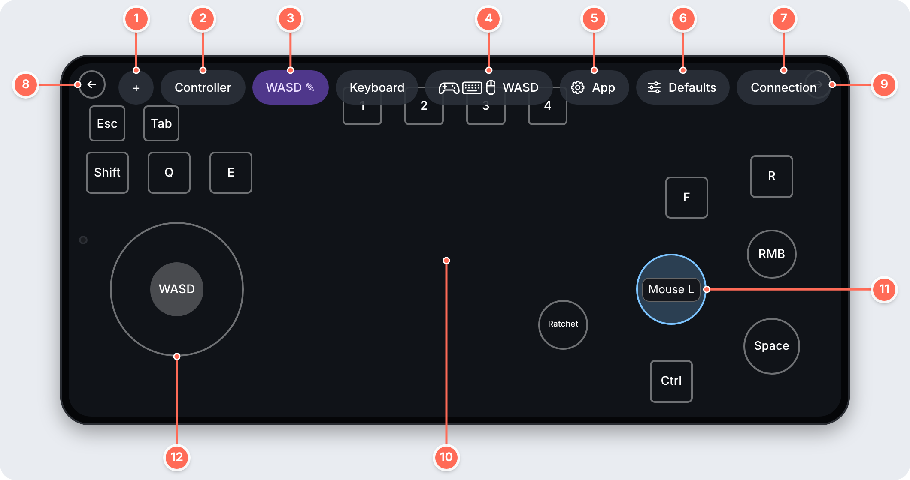

<h1 align="center">
  <picture>
    <source media="(prefers-color-scheme: dark)" srcset="./media/logo_light.svg">
    <source media="(prefers-color-scheme: light)" srcset="./media/logo_dark.svg">
    <!-- The fallback image for older browsers -->
    
  </picture>
  <br>
</h1>

# GyroPhone

GyroPhone (GP) turns an Android phone into a game controller, keyboard, mouse and gyro aim for a Windows PC, in the spirit of the [Alpakka](https://github.com/inputlabs/alpakka_firmware) controller. The phone's gyro aims like a mouse. The touchscreen is a laptop-style touchpad plus any buttons and sticks you place on it. A controller, keyboard or mouse attached to the phone (such as a clip-on 8BitDo) can be remapped too. Any input can press any output.



It connects two ways:

- **Wi-Fi or USB, with the companion** (the fast way): a small Windows tray app, `GyroPhoneCompanion.exe`, receives up to 1000 encrypted updates a second. Games see a virtual **Xbox 360**, **DualShock 4** or **DualSense** controller and real keyboard and mouse input. It can also draw the phone's motion as overlay windows over the game or for OBS.
- **Bluetooth** (nothing to install on the PC): the phone is a Bluetooth controller, keyboard and mouse, at 30 to 90 updates a second.

The reference phone is a OnePlus 15. Android 15 or newer is needed.

## Guides

- **[Quick start](docs/guide/quick-start.md)**: install, pair, play and change your first button, in pictures.
- **[Settings guide](docs/guide/settings.md)**: every page and setting on the phone and the PC, with the gestures that have no button of their own.
- **[Spec](docs/spec/README.md)**: the full description of every feature and how it works inside.

The guide's pictures are drawn from the app's own layout by `docs/guide/mockups/` (`node render.js ../images` there, with Playwright, redraws them).

## Things to know

- **Games running as administrator** don't accept keyboard and mouse input from a normal app. The companion's Home says so and offers **Restart as administrator**. The virtual controller isn't affected.
- **Anti-cheat** may ignore injected keyboard and mouse input. Use the controller output in those games.
- **DualShock 4 and DualSense output carry the phone's gyro**, for games with their own controller gyro. Turn GP's gyro mouse off in that workspace (or both move the camera), and start the game after the phone connects.
- **Safety**: if the phone goes quiet for 250 ms, or the PC locks or sleeps, everything held is let go. If the companion is killed while a key is held, it lets it go on its next start.
- **Bluetooth after an update from an old build**: remove GyroPhone in Windows' Bluetooth settings and pair again once, for smooth scrolling and media keys.

## Building

Builds run through the scripts in `.agents/` (see `AGENTS.md` and [Build and release](docs/spec/build-release.md)). On the PC, `agent-build pc` runs the quick tests, builds only the parts that changed (`gyrophone-0.1.<n>.apk` and/or `GyroPhoneCompanion.exe`), installs the APK over adb and installs the companion. You need JDK 17, the Android SDK (API 36) and the .NET 10 SDK on the `PATH` / `JAVA_HOME` / `ANDROID_HOME`. When the PC is offline, the `fallback.yml` workflow does the same on GitHub.

Tests:

```
./gradlew :core:test
dotnet test companion/GyroPhone.Companion.Linux.slnf
```

The companion's protocol and engine tests run on Linux and macOS too; the tray app builds only on Windows. The video latency test is a separate tool in `tools/latency-test`; it isn't part of the companion or any release.

## Project layout

| Folder | What it contains |
|---|---|
| `core/` | Plain Kotlin, unit-tested on the JVM: the model (workspaces, mappings, inheritance, device presets), the mapping engine, touch surfaces, gyro math, the HID descriptor, and the wire protocol and crypto. |
| `app/` | The Android app: Bluetooth HID, the Wi-Fi/USB link, gyro and other sensors, controller input, the foreground service, and the Compose UI. |
| `companion/` | The Windows companion in C# (.NET 10), with its input program also in Rust: protocol, host engine, virtual controller and SendInput, overlays, tray and main window. Shared test vectors in `core/src/test/resources/protocol/v1/` keep the sides in step. |
| `docs/guide/` | The [quick start](docs/guide/quick-start.md) and [settings guide](docs/guide/settings.md), with their pictures. |
| `docs/spec/` | The [full spec](docs/spec/README.md). |

What isn't built yet is listed at the end of the [spec overview](docs/spec/README.md).
