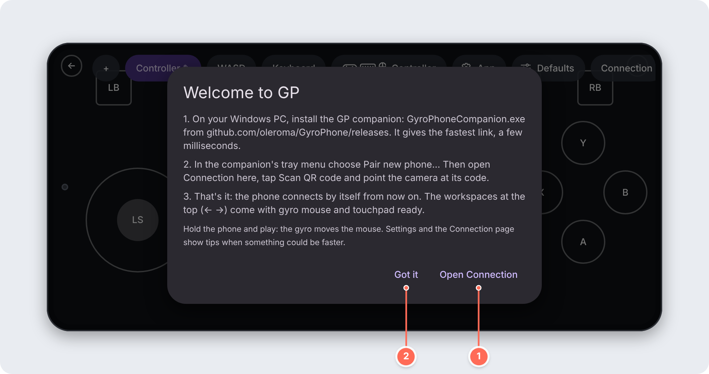
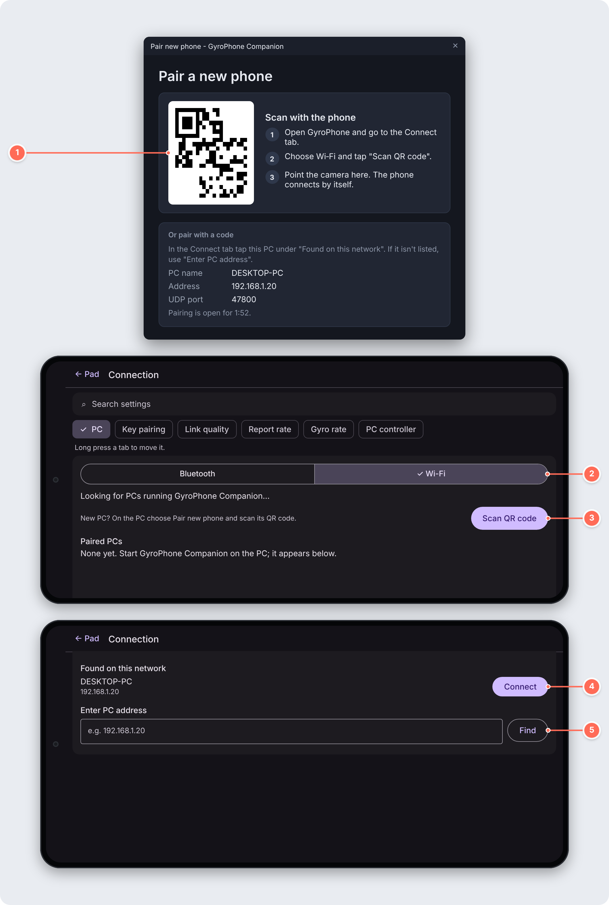
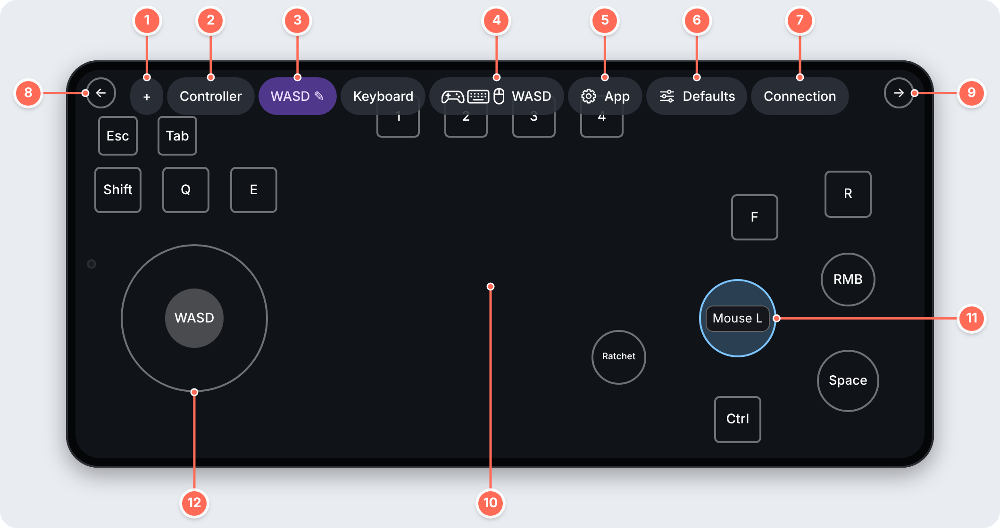
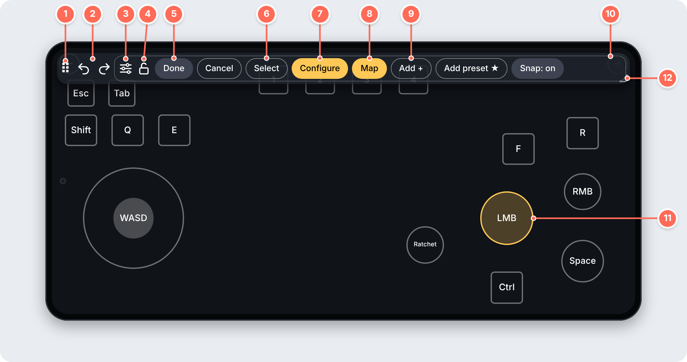
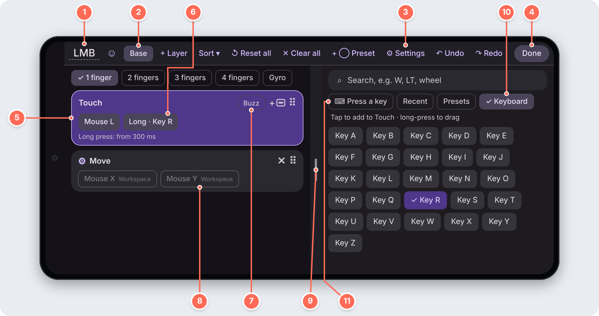

# GP quick start

GP (GyroPhone) turns your Android phone into a game controller, keyboard, mouse and gyro aim for a Windows PC. This page gets you from install to playing in a few minutes. Every setting is explained in the [settings guide](settings.md).

The pictures are drawings of GP's screens, made from the app's own layout. Numbers in red circles match the numbered lists under each picture.

## What you need

- An Android phone (Android 15 or newer) with GP installed: `gyrophone-0.1.<build>.apk` from this repo's [releases](https://github.com/oleroma/GyroPhone/releases). [Obtainium](https://github.com/ImranR98/Obtainium) can install it and keep it updated (add the repo with pre-releases on).
- A Windows 10 or 11 PC with the GP companion, `GyroPhoneCompanion.exe`, from the same release.
- Both on the same network (or a USB cable, see step 5).

## 1. Set up the PC

1. Put `GyroPhoneCompanion.exe` in `%LOCALAPPDATA%\Programs\GyroPhone\` and run it. Windows may warn that it is unsigned: choose *More info*, then *Run anyway*.
2. For a game controller on the PC, install the **ViGEmBus** driver ([ViGEmBus releases](https://github.com/nefarius/ViGEmBus/releases)). Keyboard and mouse work without it.
3. When Windows asks about the firewall, allow GP on **Private** networks. If your home Wi-Fi is set to Public, Windows may block the phone: when no phone has shown up, the companion's Home page offers **Make it Private…**.

The companion lives in the tray (by the clock). The first time, its **Pair a new phone** window opens by itself with a QR code.

## 2. Open GP on the phone

The first time you open GP, a welcome card sits over the pad.

1. **Open Connection** takes you straight to pairing.
2. **Got it** closes the card. Either button closes it for good.

## 3. Pair the phone with the PC

1. On the PC, the **Pair a new phone** window shows a QR code. Opened later from the tray menu: **Pair new phone…**
2. On the phone, open **Connection** (the last capsule on the pad's top row) and pick **Wi-Fi** (it is already picked on a new install).
3. Tap **Scan QR code** and point the camera at the PC's code. That's all: from now on the phone connects by itself whenever GP is open.
4. No camera handy? While the PC's **Pair a new phone** window is open (2 minutes; reopen it from the tray menu's **Pair new phone…**), tap **Connect** beside the PC under *Found on this network*, check that both screens show the same six-digit code, then tap **Confirm** on the phone and **Allow** on the PC.
5. PC not listed? Type its address under **Enter PC address** and tap **Find**.

**Bluetooth instead** (nothing to install on the PC, but much slower: 30 to 90 updates a second instead of up to 1000): pick **Bluetooth** on the Connection page, tap **Make discoverable**, then in Windows Settings › Bluetooth & devices › Add device pick this phone (it shows under the phone's own Bluetooth name). Use it only where you can't run the companion.

**USB cable**: turn on USB debugging on the phone, set its USB mode to *No data transfer*, and turn on the companion's *Use the phone over the USB cable* (Connection page on the PC). Plug in and allow GyroPhone when the phone asks: the link moves to the cable by itself. If the companion shows *Stop adb and use the cable* or *How to install the USB driver…*, follow it. USB tethering works too.

## 4. Play

GP opens on the **pad**: the whole screen is your controller.

1. **+** adds a workspace (a ready-made setup or a blank one).
2. Each **workspace** has a capsule. A new install has three: **Controller** (an Xbox-style pad on screen), **WASD** (keys and mouse for shooters) and **Keyboard**. Tap one to switch.
3. The workspace you're on shows **✎**. Tap it again to change its layout (edit mode, step 5).
4. The **devices** capsule: what a controller, keyboard or mouse attached to the phone does in this workspace.
5. **App** (gear): settings for the whole app.
6. **Defaults** (sliders): settings every workspace follows unless it sets its own.
7. **Connection**: the link to the PC. A dot after its name means there are tips to make the link faster.
8. **←** goes to the previous workspace. **Press ← and → together** for fullscreen (the top row hides); press both again, or Back, to leave it.
9. **→** goes to the next workspace.
10. Empty space is a **touchpad**: one finger moves the mouse, a tap clicks, two fingers scroll, as on a laptop.
11. Buttons light up while they press something.
12. Sticks work like a controller's stick (this one presses W, A, S and D).

**Aiming with the gyro**: every new workspace has the gyro moving the mouse. In WASD the gyro is always on, and holding a **ratchet** button pauses it so you can re-centre the phone (like lifting a mouse). In Controller it is the other way round: the gyro moves only while you hold the **Gyro** button. Keyboard works like Controller but has no Gyro button, so its gyro rests until you add one. You can change this per workspace (settings guide: [Gyro](settings.md#gyro)).

Keep GP on screen while you play: Android gives the fastest Wi-Fi mode only to the app in front.

## 5. Change the layout

Tap the capsule of the workspace you're on to open **edit mode**. There's no Edit button: that tap is the way in.

1. Drag the menu by its **⠿** dots to move it out of the way.
2. **↶ ↷** undo and redo. A two-finger tap anywhere also undoes, a three-finger tap redoes.
3. The sliders icon opens this **workspace's settings**.
4. The lock stops drags and pinches from moving what's already placed.
5. **Done** saves. **Cancel** throws the changes away (it asks first).
6. **Select** picks several controls at once, to move, group or sync them.
7. **Configure** opens the selected control's settings.
8. **Map** opens the selected control's mapping editor (what it presses).
9. **Add +** lists what you can add: buttons, sticks and gyro displays. Tap one, or drag it onto the pad where you want it.
10. The menu's row scrolls sideways for more.
11. A selected control shows in amber. Drag it to move it, pinch with two fingers to resize. **Tap it again** to open its mapping editor; **hold it** for Duplicate, Make global and Delete.
12. Drag the menu's corner grip sideways to make it wider; down gives the **Add +** list more rows.

## 6. Choose what a button does

Every button, stick, the touchpad and every key of an attached controller have the same **mapping editor**. Each **card** is one way of using the control (touch, tap, swipe up, ...); each **chip** on it is something it presses on the PC.

1. The control's name. Tap it to type a label, or **☺** to add symbols; empty, the button shows what its first card presses.
2. **Base** and your **layers** (a second set of mappings you can switch to, such as "Aim").
3. **⚙ Settings** for this control (look, size, haptics, stick options).
4. **Done** goes back.
5. Tap a card to pick it, then tap something in the library below to add it there.
6. **Hold a chip and drag it** to another card, or back onto the library to remove it. Tap a chip for its options (tap, long press, double tap, toggle, ...).
7. **Buzz** makes the phone tick each time this card presses something.
8. Faded chips come from the workspace or the Defaults. Tap one to turn it off here or make your own copy.
9. Drag the divider to give the cards or the library more room.
10. The library's tabs: Recent, Presets, Keyboard, Mouse, Gamepad, Gyro, Sensitivity, Touch, Phone, Layers, Other.
11. **⌨ Press a key** maps whatever you press next, on a keyboard, mouse or controller attached to the phone or to the PC. Hold several together for a combo (Ctrl + C): it's set when you let go.

## 7. Next steps

- Clip-on controller (like the 8BitDo)? Open the devices capsule to see and change what each of its buttons does: [Controllers](settings.md#controllers-the-devices-capsule).
- Set your game and in-game sensitivity so the gyro turns the camera exactly as far as you turn the phone: [Gyro](settings.md#gyro).
- Want overlays on the PC (the phone in 3D, a pointer, your key presses) for a stream? [PC overlays](settings.md#overlays).
- Something feels slow? The Connection capsule's tips and the companion's Performance page say why: [Connection](settings.md#connection-page) and [Performance](settings.md#performance).

The full description of how everything works inside is in the [spec](../spec/README.md).
