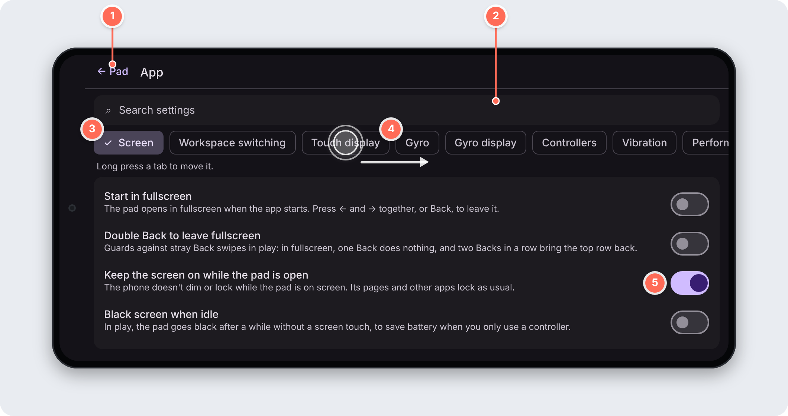
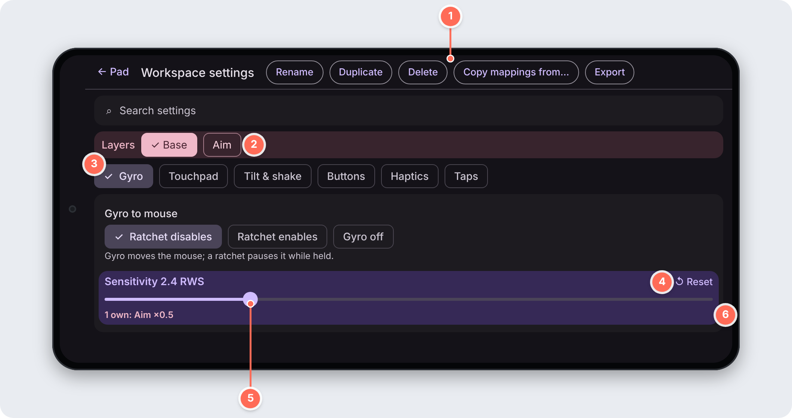
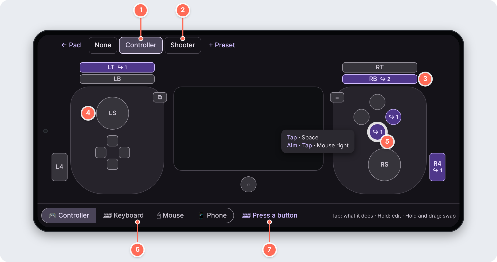
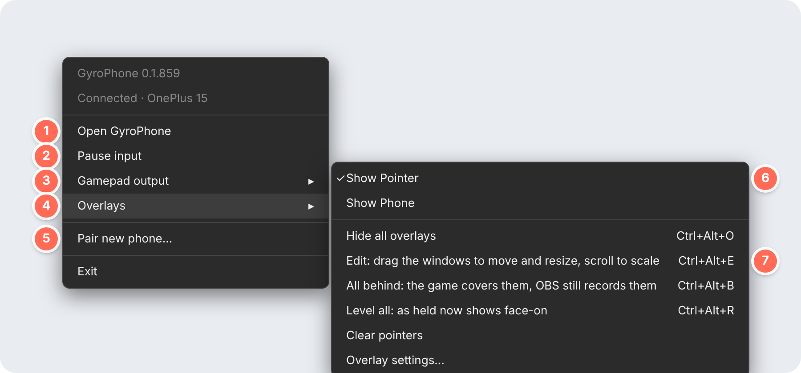
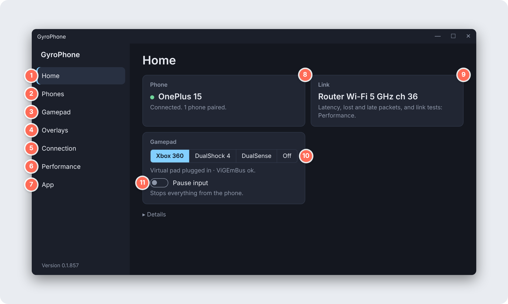

# GP settings guide

A walk through every page and setting of GP: the phone app first, then the PC companion. New to GP? Start with the [quick start](quick-start.md). How each part works inside is in the [spec](../spec/README.md).

The pictures are drawings of GP's screens, made from the app's own layout. Numbers in red circles match the lists under each picture. Things that have no button of their own (a long press, a tap on something that doesn't look tappable) are marked **Easy to miss**, and all of them are listed again [at the end](#easy-to-miss).

**Contents**

- [How settings pages work](#how-settings-pages-work)
- [Who follows whom: Defaults, workspace, layer, button](#who-follows-whom)
- Phone: [App page](#app-page), [Defaults page](#defaults-page), [Workspace settings](#workspace-settings), [Edit mode](#edit-mode), [A control's settings](#a-controls-settings), [Mapping options](#mapping-options), [Controllers (the devices capsule)](#controllers-the-devices-capsule), [Gyro displays](#gyro-displays), [Connection page](#connection-page)
- PC companion: [Tray menu](#tray-menu), [Home](#home), [Phones](#phones), [Gamepad](#gamepad), [Overlays](#overlays), [Connection](#connection-on-the-pc), [Performance](#performance), [App](#app-on-the-pc)
- [Easy to miss](#easy-to-miss)

## How settings pages work

Every settings page in the phone app looks the same.

1. **← Pad** goes back (so does the phone's Back).
2. **Search** finds any setting by its words. While you type, the tabs hide and every category with a match shows, open.
3. **Category tabs**: tap one to show that category.
4. **Easy to miss:** hold a tab and drag it sideways to reorder the tabs. The order and the last tab you used are remembered.
5. Switches, sliders and choices. Each has a short explanation under it.

**Sliders.** Drag the handle from where it is (it doesn't jump to your finger). **Easy to miss:** a tap on a slider, without dragging, opens a box to type the exact value, and a typed value may go past the slider's ends.

Pages that belong to a workspace add a few things:

1. The workspace's actions, always on top: **Rename**, **Duplicate**, **Delete** (not the last workspace), **Copy mappings from…** (bring in another workspace's mappings, with its buttons or onto yours by name) and **Export** (save this workspace to a file to share or keep).
2. **Layers**: pick **Base** or one of this workspace's layers. A layer's page shows only what a layer may change, and its values apply while that layer is in use.
3. Category tabs, as above.
4. A setting this level sets itself is highlighted, with **↺ Reset** to follow the level above again.
5. Tap the slider to type a value.
6. The pink line lists the levels below that set their own value, such as a layer or a button ("1 own: Aim ×0.5"). Tap it to see them all; **Reset children** makes them all follow this value again (it asks first).

## Who follows whom

Settings and mappings pass down four levels: the **Defaults** → each **workspace** → its **layers** → each **button**. A level stores only what it changes; everything else follows the level above. So change something once in the Defaults and every workspace that hasn't set its own picks it up.

- In settings, a highlighted value with **↺** is set at that level.
- In the mapping editor, faded chips come from the level above. Tap one to **Override** it (it stops working here) or **Replace** it (make your own copy).
- The **App** page is outside this chain: its settings are for the whole app.

## App page

The **App** capsule (gear) on the pad. Settings for the whole app, the same in every workspace.

**Screen**

- **Start in fullscreen** (off): the pad opens with its top row hidden.
- **Double Back to leave fullscreen** (off) and **Double Back time** (400 ms): a guard against mistouches. In fullscreen one Back does nothing; two within the time bring the top row back.
- **Keep the screen on while the pad is open** (on).
- **Black screen when idle** (off) and **Black screen after** (1 min): the pad goes black after this long without a touch, to save battery while you play with a controller. Gyro, controllers and the link keep working. **Easy to miss:** the first tap on the black screen only wakes it and presses nothing. A **Black screen** mapping (Other tab) blacks it out at once. GP never changes the brightness.
- **Screen rotation** (Auto): Auto, Landscape, Portrait, or forced landscape or portrait. Landscape and portrait keep separate layouts.
- **Send input only while the pad is open** (on): nothing reaches the PC from the gyro or touch while you're in a menu or another app, and leaving the pad lets go of everything held. Under it, **Hardware devices too** (off): when on, attached controllers, keyboards and the volume buttons also stop outside the pad.

**Workspace switching**

- **Wrap around** (off): → on the last workspace goes to the first.

**Touch display** (what the pad draws over your fingers)

- **Show touches**, **Trail behind fingers** (with its length and fade) and **Fade out after lift**.
- **Show mappings on buttons** (on): each button shows a small frame with what it sends right now, and every Toggle it has, on (green) or off (grey).
- **Swipe line**: a line from where a swipe started to its distances.
- **Move rulers**: a sliding ruler while a finger's move changes something.
- **Sliders on buttons** (on) and **Slider colour**: a button that works as a slider fills up to its value.

**Gyro**

- **Jitter cutoff** and **Smoothing below** (both off): calm the gyro's tiny shakes. Off is the rawest and fastest.
- **Slider cap**: the top end of every gyro sensitivity slider (10 RWS, or 64 counts per degree for workspaces without a game). Typed values can still go higher.

**Gyro display** (the 3D displays you place on the pad)

- **Parallax edge** (off): outlines inside the screen edge that slide as you turn (Turn) or tilt (Tilt) the phone.
- **Fade when phone rests** (on): the displays fade while the phone lies still, and come back at once when you pick it up. **Flat within**, **Still below**, **Quiet for**, **Fade to** and **Fade over** fine-tune it.

**Controllers**: the game controllers attached to the phone right now.

**Vibration**

- **Vibrate with game rumble** (on): when a game rumbles the PC's virtual Xbox 360 or DualShock 4 controller, the phone vibrates with it.

**Performance**

- **Read USB controllers directly** (on): GP reads a controller on the phone's USB port itself, skipping Android's slower input path, so a press reaches the PC sooner. Android asks once whether GP may use the controller; if you missed it, an **Allow** button shows here.
- **Diagnostics** (off): one switch that records everything on the phone and the PC into memory, to find the cause when something misfires or lags. While it's on, the pad shows a small red dot in its top-left corner. **Keep** (3 min) is how much a save covers, **Save** writes it out (on both sides at once). Off, nothing is measured or logged.

**Backup**

- **Export everything** saves every workspace, the Defaults, device presets, your saved buttons and presets in one file (`GPEverything.gyrophone.json`).
- **Import everything…** replaces your setup with such a file (it asks first and keeps a backup).
- **Automatic backups**: copies GP takes by itself (on each update, before an import or restore, and every 10 minutes after a change), newest 20 kept, with their time and reason. **Restore** puts one back (it asks first, and backs up what you have now so a restore can be undone).

**About**: the version, the gyro sensor in use and how often it's read.

## Defaults page

The **Defaults** capsule (sliders icon) on the pad. The same categories as a [workspace's settings](#workspace-settings), plus **Mappings**: the touchpad and gyro mappings every workspace starts from. Every workspace follows these values unless it sets its own. Each value that differs from GP's built-in one is highlighted with **↺**, and the pink line under a setting lists the workspaces, layers and buttons that set their own.

## Workspace settings

Open them from edit mode's menu (the sliders icon), or **⚙ Settings** in the touchpad's mapping editor. Each category below can also be set in the Defaults, and most in a layer.

### Gyro

- **Gyro to mouse**: how the gyro and ratchets work together.
  - **Ratchet enables** (new workspaces): the gyro rests until you hold a ratchet button.
  - **Ratchet disables**: the gyro always moves; holding a ratchet pauses it, like lifting a mouse to re-centre.
  - **Gyro off**: the gyro isn't read at all.
  A **Toggle gyro** mapping swaps between the first two until you change workspace.
- **Game**: pick your game and type your in-game sensitivity (or the counts for one full turn; **Measure** helps find it). Then sensitivity is shown in **RWS** (real world sensitivity): how many degrees the game's camera turns per degree you turn the phone. 1.0 means one to one.
- **Sensitivity**: how far the gyro moves the mouse (16 counts per degree, or the RWS above). Each axis's **⚙** can give it its own value, or make it follow the shared one, another axis or a named sensitivity, times a scale.
- **Acceleration**: a curve that turns fast swings further than slow ones (Off, Light, Strong or your own). **Easy to miss:** in the curve editor, tap to add a point, drag to move it, hold a point to remove it.
- **Inertia** and **Glide**: after a ratchet stops the gyro, the view glides on for a moment (Smooth or Linear, 325 ms) instead of stopping dead.
- **Gyro space**: **Local** (turns as the phone turns, default), **World** (turns about the real up, however you hold the phone) or **Player** (left-right turning blends the phone's yaw and roll by how you tilt it, forgiving when you lean back or lie down; up-down stays the phone's). Each gyro card's ⚙ in the mapping editor can pick its own.
- **Yaw axis** and **Set orientation**: which of the phone's axes counts as left-right turning. **Set orientation** takes the way you hold the phone now as straight, and levels every gyro display and PC overlay.
- **PC pad yaw / pitch / roll** (DualShock 4 and DualSense output): which phone axis drives the PC controller's own gyro, and Invert.
- **Drift correction** (Base only, one setting for the phone): **Android** (default) or **GP**. With GP: **Calibrate** (lay the phone still), **Clear**, and **Re-measure when the phone rests**.

### Touchpad

How the empty space of the pad (and every button that swipes) moves the mouse and reads swipes, in groups:

- **Cursor & scrolling**: speed (1.5), acceleration, inertia (the cursor glides on after you lift), deadzone, scroll speed, natural scrolling.
- **Move X & Y**: each direction's own speed and options.
- **Quick swipes** and **Held swipes**: how far a swipe must go and how wide each direction's slice is.
- **Length zones**: lengths for swipes that do different things the further you go.

### Tilt & shake

- **Tilt range** (30°): how far you tilt for a full tilt.
- **Tilt deadzone** (off), per direction.
- **Use compass when flat** (off): reads sideways tilt with the phone lying flat (magnets and metal can bend it).
- **Shake strength** (14 m/s²): how hard a shake must be.

### Buttons (Base only)

- **Control opacity** (100 %): how see-through the workspace's buttons and sticks are.

### Haptics

- **Feel**: the system's tick or your own strength and length.
- **Ticks play**: On press / enter (default), On release / exit, or Both.

Haptics play only while a PC is connected.

### Taps

- **Tap time** (300 ms): the longest a tap may last, when a long press starts, and the gap allowed for a double tap. A **Tap time** slider mapping (Touch tab) can change it while you play.

## Edit mode

Tap the capsule of the workspace you're on (**Easy to miss:** there is no Edit button). The [quick start](quick-start.md#5-change-the-layout) shows the menu. Besides what's there:

- **Easy to miss:** tap a selected control again to open its mapping editor. Where controls overlap, a tap picks the next one underneath and a **double tap** opens it.
- **Easy to miss:** hold a control (half a second) for its menu: **Mappings**, **Duplicate**, **Save as preset**, **Ungroup**, **Make global** / **Make local** and **Delete**.
- **Easy to miss:** a tap on empty space opens the touchpad's mapping editor.
- Pinch with two fingers to resize the selected control; spread your fingers mostly one way to change only its width or height.
- **Easy to miss:** a two-finger tap undoes, a three-finger tap redoes, here and in the mapping editor.
- **Select** turns taps into picking several controls (a drag then moves them all), with **Group** / **Ungroup** to keep them together, and **Sync +**: **Size** (picked controls resize together), **Flip** (Toggle buttons turn on and off together) and **Never both** / **One at a time** (at most one of them on).
- **Save as preset** (with a group picked) saves the group for **Add preset ★**.
- **Add preset ★**: your saved buttons, sticks, displays and groups. Hold one still for a moment to pick it up and drag it onto the pad. Hold it in the list to rename or delete it.
- **Snap: on/off**: snap edges to a grid.
- **Devices: <preset>**: which [device preset](#controllers-the-devices-capsule) this workspace uses for attached controllers, keyboards and mice.
- **Make global** puts a control in every workspace: a change to it anywhere changes it everywhere, and global controls show a small 🌐. The ← and → buttons are global. If they're gone, **Add preset ★ → Workspace arrows** brings them back.

## A control's settings

**⚙ Settings** in a control's mapping editor, or **Configure** in edit mode. The tabs:

- **Look**: label, shape, size, layer order (front or back), **Own opacity** and **Fade when idle** (fades after 3 s without a touch, comes back at once).
- **Layers**: **Follow layers** (when a layer changes, a finger already on the button lets go and takes the new layer's mapping at once).
- **Press**: **How** the button's chips work unless they set their own: **Held** (default), **Once**, **Toggle** or **Repeat**. A Toggle button also has **Initial state** (On or Off when the workspace opens) and **Also ends on** (a Let go mapping, the next input, the same keystroke, or a timer).
- **Gyro** and **Touchpad**: the gyro's sensitivity and acceleration, and the touchpad's speed, while this button is held (for example, slower aim while scoped).
- **Haptics**: this control's own **Feel** and **Ticks play**, over the workspace's.
- **Swipes** (a button that swipes): its own swipe settings over the workspace touchpad's.
- **Stick**: deadzone, zones (4, 4 with diagonals pressing two, or 8), the **Outer ring**, and **Flick stick**: push the stick and the camera snaps to face that way, then turns with the stick as you circle it (needs the workspace's game set, under [Gyro](#gyro)). The gyro keeps the fine aim.

On top, fixed: **Duplicate**, **Save as preset** and **Delete**.

## Mapping options

The [quick start](quick-start.md#6-choose-what-a-button-does) shows the mapping editor. **Tap a chip** to open its options:

- **Where** (buttons and sticks): **Touch** (the press itself), **Inside** (any finger inside the button, wherever it started) or **Outside** (a finger that started on it and slid off).
- **When**: **On touch** (held from touch to lift), **Tap**, **Long press**, **Double tap** or **Release**. On swipes they read On swipe, Quick swipe, Long hold, Double swipe. A tap waits for a possible double tap only when the double tap does something else.
- **How**: **Held**, **Once**, **Toggle** or **Repeat ×N** (a double click is Mouse left Repeat ×2). **↺ Follow the button** makes it follow the button's How again.
- **Also ends on** (Toggle): a tap, a Let go mapping, a timer, the next input (a sticky Shift) or the same keystroke.
- **Range** (sticks, triggers, sensitivities): what the input's start and end send.
- **Advanced**: start delay, end delay, **Hold time** (the shortest a press lasts, 80 ms, so apps that check keys slowly still see it) and **Cycle** (the chips take turns, one per press).
- **Save as chip preset** keeps it for the Presets tab.

Elsewhere in the editor:

- **Layers**: **+ Layer** adds one (up to 9). A **Layer** chip (Layers tab) **switches** to it, lays it **over** Base, or uses it only **while held**. **Layer back** returns to the one before. **Easy to miss:** hold a layer chip to rename or delete it.
- **Sort ▾**: card order (Default, Mapped first, or your own; drag a card by its ⠿).
- **↺ Reset all** follows the level above for everything (asks first). **✕ Clear all** clears everything (Undo brings it back).
- **+ Preset** saves the whole control as a preset. A card's **+** saves that card. Tapping a preset asks **Add** or **Replace**, with **Apply with settings**.
- **Swipe card**: one line per direction (Any, ↑ → ↓ ←). **Easy to miss:** drag a chip to another line to change its direction, and drag past a line's divider to make a new length zone (a different action the further you swipe).
- **Stick direction cards**: chips after the **Outer** separator fire only when the stick is pushed past its outer ring (W before it, Shift after it = sprint). **Easy to miss:** tap the separator for the Outer ring's setting.
- **Value chips on Position or Move** turn a button into a slider: where your finger is (Position) or how far it moves (Move) sets a stick, trigger or sensitivity. With Toggle and no end, the value is kept and saved.
- **Show on pad** (touchpad only): shows the touchpad's label at the top of the pad.

## Controllers (the devices capsule)

The devices capsule on the pad (gamepad, keyboard and mouse icons with the preset's name). A **device preset** says what a controller, keyboard, mouse and the phone's volume buttons do. Each workspace uses one.

1. The preset in use here. Tap another tab to use it in this workspace at once (nothing to save). **None** makes attached devices do nothing.
2. **Easy to miss:** hold a preset's tab to rename, duplicate, reset or delete it. **+ Preset** adds one.
3. Purple controls do something other than themselves; the number after ↪ is how many things.
4. Grey controls do just themselves (A sends A).
5. **Tap** a control to open its mapping editor. **Easy to miss:** **hold** it to see what it does, and **hold and drag it onto another control** to swap everything the two do (a bar offers **Undo** for 5 s).
6. Switch between **Controller**, **Keyboard**, **Mouse** and **Phone** (the volume buttons).
7. **⌨ Press a button**: press any control on an attached device and its mapping editor opens.

More:

- **Stick tuning** (a stick's ⚙): inner deadzone, outer deadzone, curve (Linear, Soft, Aggressive), sensitivity, how wide each direction's slice is, the **Outer ring**, and **Flick stick**. A picture shows the slices and a dot follows the real stick.
- **Trigger tuning**: where **Press** (half way) and **Full pull** start.
- **Gyro tab** on a controller button: what the gyro does while it's held, with its own sensitivity (its ⚙).
- **Volume buttons**: unmapped, they turn the **PC's** volume while the pad is open. Map them to anything else on the Phone view.
- A controller attached to the phone works with the pad open; with **Read USB controllers directly** on, a USB one is read even with GP in the background.

## Gyro displays

Add them in edit mode (**Add + → Display…**): 3D phone, Ratchet ring, Speed graph, Attitude indicator, Bubble disk, 3D shape and Pointer. **Easy to miss:** tap a selected display again for its settings (it has no mapping editor). Their settings match the PC overlays' (see [Overlays](#overlays)): **Look**, colours, and **Turning** (**Turns with** the phone, the game's camera, or as a trackball; **Level** sets the way you hold the phone as face-on). The Pointer has more tabs (Paint, Snake, Colours). Displays are drawn on their own thread, so they never slow a press.

## Connection page

The **Connection** capsule on the pad. A dot after its name means the **Setup tips** card on top has advice, such as "PC on Wi-Fi too", "Phone on 2.4 GHz", "Battery saver on" or "GP not Unrestricted", each with a button to the Android setting that fixes it where there is one.

- **Bluetooth | Wi-Fi**: the link. Wi-Fi (with the companion) is far faster and is the default on a new install.
- **PC** (Wi-Fi): **Scan QR code**, **Paired PCs**, **Found on this network** with **Connect**, and **Enter PC address** with **Find**. On Bluetooth: **Make discoverable** and the paired PCs.
- **Key pairing** (Wi-Fi): this phone's key, share or import key files, trusted PCs, and **Connect automatically** (on).
- **Link quality** (Wi-Fi): packets a second, loss, latency, jitter, the Wi-Fi radio and whether the low-latency mode is held.
- **Report rate**: Bluetooth 30 to 90 Hz (60); Wi-Fi 250, 500 or 1000 Hz (1000).
- **Gyro rate**: 1, 2 or 4 kHz (4 kHz): how often GP reads the gyro.
- **PC controller** (Wi-Fi): **Use PC controller for gyro ratchet** (off): a controller plugged into the PC can ratchet the phone's gyro, with no round trip to the phone.
- **Stop when idle** (10 min): the link stops after GP has been off screen this long.

## Tray menu

Right-click the GP icon by the clock. On top: the version and the link's state (and a problems line when something needs fixing, which opens Home).

1. **Open GyroPhone**: the main window. **Easy to miss:** a left click on the tray icon does this too (or pairs a new phone, see [App](#app-on-the-pc)).
2. **Pause input**: lets go of everything and sends nothing to games until you turn it off.
3. **Gamepad output**: Xbox 360 (default), DualShock 4, DualSense (only with the GyroPhone pad driver) or Off (keyboard and mouse only).
4. **Overlays**: the overlay switches.
5. **Pair new phone…**: the pairing window with its QR code.
6. **Show <overlay>**: one switch per overlay window.
7. **Edit**: drag the overlay windows to move and resize them, scroll over one to scale it (**Ctrl+Alt+E**).

Also under Overlays: **Hide all overlays** (**Ctrl+Alt+O**), **All behind** (the game covers them, OBS still records them, **Ctrl+Alt+B**), **Level all** (the way you hold the phone now shows face-on, **Ctrl+Alt+R**), **Clear pointers** and **Overlay settings…**. **Exit** closes GP on the PC.

## Home

The companion's main window has a sidebar of pages:

1. **Home**: what's wrong (if anything) with a button to fix it, then the cards below.
2. **Phones**: pairing and paired phones.
3. **Gamepad**: the virtual controller games see.
4. **Overlays**: windows that show the phone's motion over the game or in a stream.
5. **Connection**: network, firewall and USB.
6. **Performance**: link numbers, Diagnostics and speed settings.
7. **App**: startup, tray icon, Press a key.
8. **Phone** card: which phone is connected.
9. **Link** card: the way the packets go, such as "Router Wi-Fi · PC Ethernet".
10. **Gamepad** card: the output games see.
11. **Pause input**.

**Details** at the bottom has the full status. A warning bar shows **Restart as administrator** when a game running as administrator blocks keyboard and mouse input.

## Phones

- **Pair new phone**: opens the pairing window (QR code, or a six-digit code to **Allow** or **Deny**).
- **Paired phones**, each with **Forget**.
- **This PC**: its key, with **Open keys folder**.

## Gamepad

- **Output**: Xbox 360, DualShock 4, DualSense (only while the GyroPhone pad driver works) or Off. DualShock 4 and DualSense also carry the phone's gyro for games with their own controller gyro. **Easy to miss:** then turn GP's gyro mouse off in that workspace, or both move the camera, and start the game after the phone connects.
- **Input**: **Pause input**.
- **Driver**: whether ViGEmBus works; if not, **Install driver (ViGEmBus)…** and **Try again**.

## Overlays

Windows that draw the phone's motion over your game or for OBS.

- On top: **Edit** (drag and resize the windows; otherwise the mouse goes through them), **Hide all**, **Level all** and **All behind**.
- The list of overlay windows, each with its **Show** switch, and **Add overlay**: **Phone** (the phone in 3D with your layout and presses), **3D shape**, **Attitude indicator**, **Bubble disk**, **Ratchet ring**, **Speed graph**, **FPS** (the game's frame rate), **Keys** (the controller keys you press and what they send) and **Pointer**. Your saved presets show after them with a ★ (**Easy to miss:** right-click one to rename or delete it).
- The picked window's settings: its **label** on top, then tabs:
  - **Window**: **Show this overlay**, **Behind other windows**, size, opacity, background (**Transparent**, or **Green** for an OBS chroma key), **Quality** and **Frame rate**.
  - **Look**: the kind's own options and its colours.
  - **Turning**: **Turns with** the phone, the game's camera or as a trackball; **Gravity**, **Compass**, **Ease back to straight**, **Turn amount** and **Level**.
  - The Pointer also has **Paint**, **Snake** and **Colours**.
  - **Save as preset** and **Remove this overlay**.
- **Shortcuts**: change the four keyboard shortcuts.
- **Fade when phone rests**: overlays fade while the phone lies on the table, with the same options as the phone's displays, plus **Also when the phone stops sending**.

**Easy to miss** (with Edit on): a click without a drag picks a window for its settings, clicking where windows overlap picks the next one, the mouse wheel over a window scales it (hold Shift for small steps), and a double-click opens its settings. OBS finds each window by its title, "GyroPhone Companion <kind> overlay: <label>".

## Connection on the PC

- **Wi‑Fi**: **Network** (with **Make it Private…** when your network is Public, which keeps GP closed) and **Firewall** (**Allow…** if Windows blocks GP).
- **USB cable**: **Use the phone over the USB cable** (off; set the phone's USB mode to *No data transfer*), **Stop adb and use the cable** when adb holds it, **How to install the USB driver…**, and **USB tethering** (**Allow…**).
- **This app**: the server's port and addresses, and **Restart as administrator**.

## Performance

Measured only while this page is open or Diagnostics is on.

- **Link**: the way the packets go, packets a second, loss, signal, round trip, latency and jitter, with graphs. **Measure buttons** times your presses ([latency test](../spec/pc-latency-test.md)).
- **Diagnostics**: the same switch as the phone's (they follow each other), **Keep**, **Save**, **Open debug folder**, and the **A/B test** (**A/B input program** or **A/B overlays**, **Switch every** 1 to 10 min, **Stop A/B**): it switches one thing back and forth while you play, so you can compare the two on the same day. A warning names programs keeping the PC busy.
- **Results**: one row per saved record (loss, late packets, latency, frame rate, CPU), with **Open results** and **Open folder**.
- **Mouse**: **Catch-up time** (16 ms): a late stretch of mouse motion is spread over at most this long instead of jumping.
- **Keyboard and mouse**: **Use input driver** (off, only shown with the optional driver installed) and **Delivery test** (times each mouse move from GP to a window in front, like a game).
- **Input program**: **Use the Rust input program** (off): which of GP's two input programs runs. Both work the same way; it falls back to the other by itself if Rust fails.
- **Log**: **Open log folder**.
- **Set up FPS helper**: shown when an FPS overlay needs it. It asks once for administrator rights, then the frame counter works without asking again.

## App on the PC

- **Startup**: **Start with Windows** (off) and **Start when my phone appears** (a tiny watcher starts GP when your phone looks for this PC).
- **Tray icon**: what a left click does: **Opens this window** or **Pairs a new phone**.
- **Press a key**: **Use this PC's keys for Press a key** (on: the phone's ⌨ Press a key also hears this PC's keyboard, mouse and controller; it only listens, the key still does what it does in the game) and **Notify when the phone listens for a key** (on).
- **About**: the version.

## Easy to miss

Everything in GP that has no button of its own:

**On the pad**
- Tap the capsule of the workspace you're on to open edit mode.
- Hold **←** or **→** for fullscreen.
- Hold a capsule and drag it to reorder the top row.
- The first tap on a black screen only wakes it.
- A finger on a button can also aim like the touchpad: press and slide in one motion.

**In edit mode**
- Tap a selected control again for its mapping editor (double-tap where controls overlap).
- Hold a control for Duplicate, Make global, Delete and more.
- Tap empty space for the touchpad's mapping editor.
- Two-finger tap undoes, three-finger tap redoes.
- Pinch mostly one way to change only width or height.
- Hold a saved preset still, then drag it onto the pad.
- Drag the menu's corner grip to resize it.

**In the mapping editor**
- Tap the name at the top to type a label.
- Hold a chip to drag it to another card or back to the library.
- Tap a faded chip to override or copy it.
- Hold a layer chip to rename or delete it.
- Drag a swipe chip to another line to change its direction; drag past a divider for a new length zone.
- Tap a stick's **Outer** separator for its outer ring.
- Two-finger tap undoes, three-finger tap redoes.

**On settings pages**
- Tap a slider to type its exact value.
- Hold a category tab and drag it to reorder.
- Tap the pink line under a setting to see every level that sets its own.

**On the devices screen**
- Hold a preset tab to rename, duplicate or delete it.
- Hold a control to see what it does; drag it onto another to swap them.

**On the PC**
- A left click on the tray icon opens the window (or pairs, your choice).
- With overlay Edit on: click to pick, click again where windows overlap, scroll to scale, double-click for settings.
- Right-click a saved overlay preset to rename or delete it.
